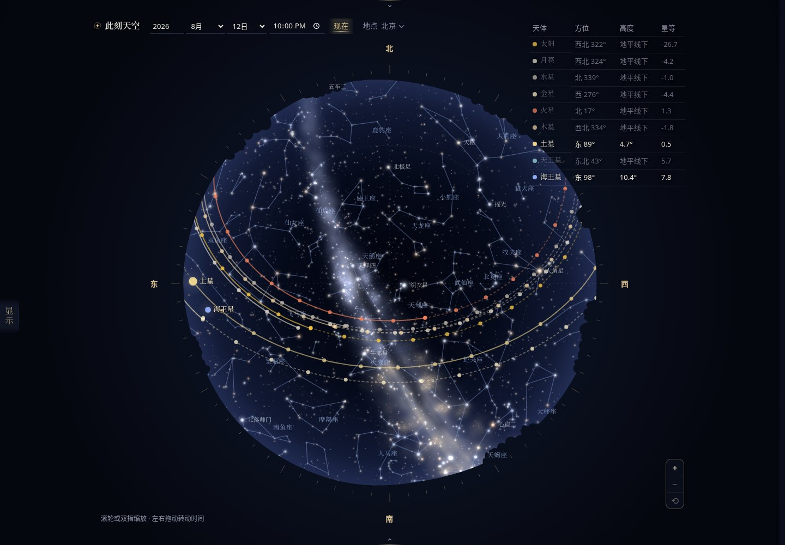
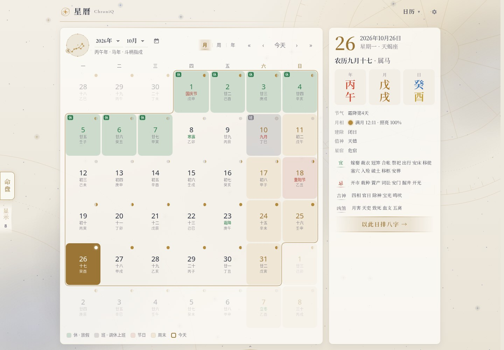
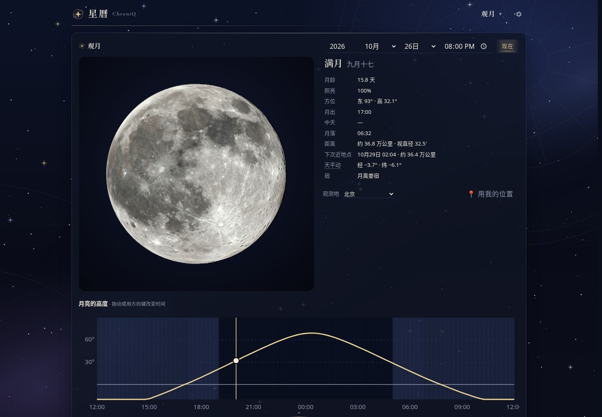
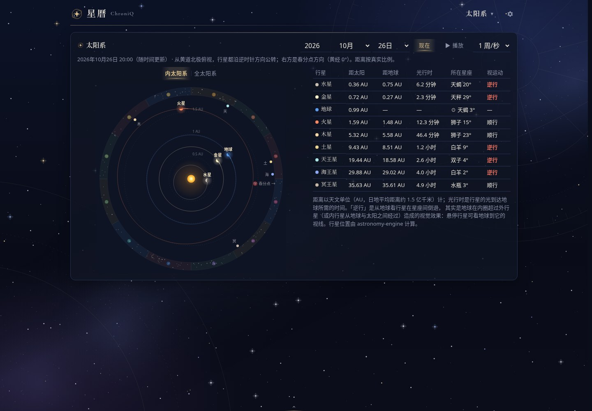
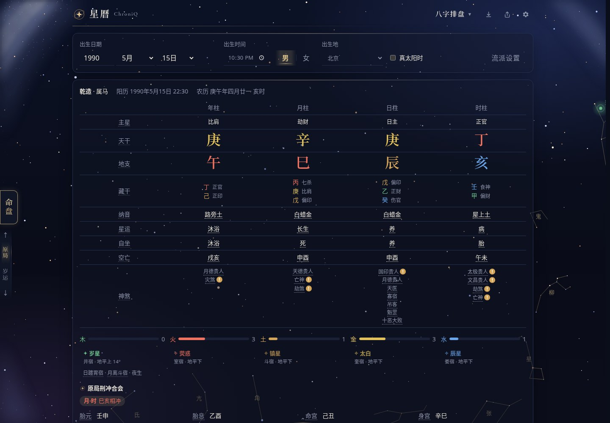
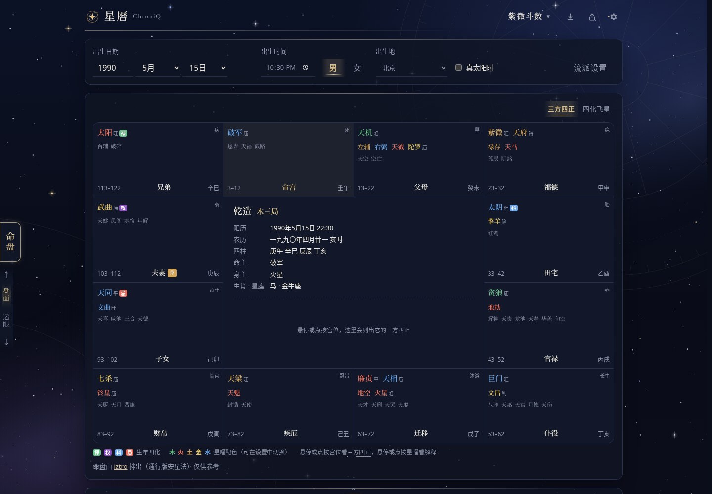
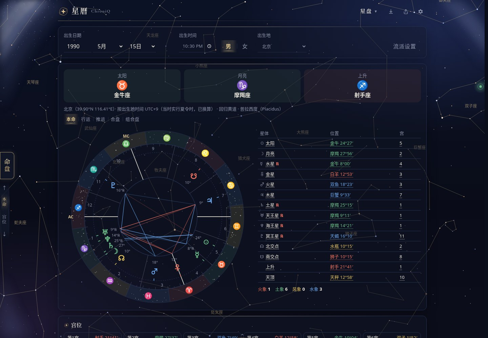

<p align="center">
  
</p>

<h1 align="center">星曆 ChroniQ</h1>

<p align="center">
  <b>抬头看星，低头查历。🌌</b><br />
  从「今天农历几号」到「今晚木星在哪」，再到一张属于你的命盘。
</p>

<p align="center">
  <a href="https://redcarpg.github.io/ChroniQ/"></a>
</p>

<p align="center">
  <a href="https://github.com/RedCarpG/ChroniQ/actions/workflows/pages.yml"></a>
  
  
  
</p>

<p align="center">
  <b>中文</b> · <a href="README.en.md">English</a> · <a href="docs/SPEC.zh-CN.md">中文 Spec</a> · <a href="docs/SPEC.en.md">English Spec</a>
</p>

---

## 🌌 给浏览器开一扇天窗

不用注册，不用配置 API，也不用先懂一堆术语。打开网页，日历、月亮、星空和排盘工具都在这里。

[](https://redcarpg.github.io/ChroniQ/)

<p align="center"><sub>真实页面截图 · 时间与地点都可以自己选 · 点图直接体验</sub></p>

- **📅 日子要过明白**：农历、节气、月相、宜忌，中法节假日，一张日历看清楚。
- **🔭 星空不只当壁纸**：找星、看轨迹、切换西方星座和中国星官，放大后还能看到更多暗星。
- **🧭 不同取法，自己选**：八字、紫微、西洋星盘放在一起，流派设置附说明与出处。
- **🔒 出生信息留在本机**：本地计算、本地保存；支持分享链接、图片导出和打印。
- **📱 手机也能装进口袋**：响应式布局、深浅主题、中文 / English，完成缓存后可离线使用。

> 🌙 今天宜：给忙碌暂停一下，看看月亮。

## 📸 先逛一圈

七个页面，各管一片天地。上面是天象，下面这些也都是当前版本的真实截图，点击可看大图。

<table>
  <tr>
    <td width="50%" valign="top">
      <a href="docs/images/calendar.jpg"></a>
      <br /><b>📅 日历｜今天是什么日子？</b><br />
      月 / 周 / 年视图，农历、节气、月相、宜忌，以及已保存命盘的重要日期。
    </td>
    <td width="50%" valign="top">
      <a href="docs/images/moon.jpg"></a>
      <br /><b>🌕 观月｜今晚的月亮长这样</b><br />
      看看月面纹理，查看天平动、照亮比例和当地月出月落。
    </td>
  </tr>
  <tr>
    <td width="50%" valign="top">
      <a href="docs/images/solar.jpg"></a>
      <br /><b>🪐 太阳系｜让行星跑一会儿</b><br />
      行星轨道、距离、光行时、顺逆行，还能播放时间，看它们沿轨道前进。
    </td>
    <td width="50%" valign="top">
      <a href="docs/images/bazi.jpg"></a>
      <br /><b>🧮 八字｜四柱与岁运，一起看</b><br />
      十神、神煞、大运流年，真太阳时和流派规则可切换。
    </td>
  </tr>
  <tr>
    <td width="50%" valign="top">
      <a href="docs/images/ziwei.jpg"></a>
      <br /><b>✨ 紫微斗数｜十二宫里慢慢逛</b><br />
      星曜、四化飞星与多级运限，点选宫位和运限查看关联。
    </td>
    <td width="50%" valign="top">
      <a href="docs/images/star.jpg"></a>
      <br /><b>♈ 西洋星盘｜不止一个太阳星座</b><br />
      本命、行运、推运、合盘、组合盘，宫位制等计算方法可选。
    </td>
  </tr>
</table>

截图使用演示出生数据与固定观测时刻，不代表打开网页时的实时天象。截图设置见 [图片说明](docs/images/README.md)。完整操作见 [功能详解](docs/features.md)。

## 🛠️ 想自己跑起来？

推荐 **Node.js 22**（与 CI 一致）和 npm。在仓库根目录执行：

```bash
npm ci
npm run dev
```

就这两步。没有后端、数据库或 API 密钥需要准备。

<details>
<summary><b>展开开发命令与项目结构</b></summary>

```bash
npm test           # Vitest 测试
npm run typecheck  # TypeScript 检查
npm run build      # 类型检查并生成 dist/
npm run preview    # 预览生产构建，检查 PWA 与离线能力
```

技术栈：**React 19 + TypeScript + Vite**。`src/components/` 放页面与交互，`src/lib/` 放计算和数据逻辑，`src/i18n/` 放界面翻译；`legacy/` 是旧版参考实现。

开发服务器不注册 Service Worker。推送到 `main` 后，GitHub Actions 会测试、构建并部署到 GitHub Pages；PR 只测试和构建，不部署。

更多内容见 [开发指南](docs/development.md)。

</details>

## 🔒 数据和离线，说明白一点

**出生信息、命盘和偏好保存在当前浏览器，不提供账号或云同步。** 分享链接的 `#` 片段包含出生数据和可选地点，接收者可以读取；它不是加密存储。

首次联网加载并完成缓存后，应用可离线使用。部分字体切片和高分辨率月球贴图按需缓存，离线未命中时使用备用字体或较低分辨率资源。新版本等待旧版页面全部关闭后激活。

## 📚 文档导航

| 想了解什么 | 从这里开始 |
| --- | --- |
| 每个页面怎么玩 | [功能详解](docs/features.md) |
| 为什么流派算出来不一样 | [流派说明与出处](docs/schools.md) |
| 开发、翻译和生成脚本 | [开发指南](docs/development.md) |
| 产品范围、技术契约与验收标准 | **[中文 Spec](docs/SPEC.zh-CN.md) · [English Spec](docs/SPEC.en.md)** |

## 💫 感谢这些「幕后星星」

历法与八字：[tyme4ts](https://github.com/6tail/tyme4ts) · 紫微斗数：[iztro](https://github.com/SylarLong/iztro) · 星体位置：[astronomy-engine](https://github.com/cosinekitty/astronomy) · 星表：[d3-celestial](https://github.com/ofrohn/d3-celestial)

字体：[Noto Serif SC](https://fonts.google.com/noto/specimen/Noto+Serif+SC) / [Cormorant Garamond](https://fonts.google.com/specimen/Cormorant+Garamond)（SIL Open Font License）。月球贴图来源见 [资源说明](src/assets/moon/README.md)。

---

<p align="center">
  <a href="https://redcarpg.github.io/ChroniQ/"><b>🚀 不如现在就打开，看看你头顶的星空。</b></a><br />
  <sub>命理内容仅供文化参考。</sub>
</p>
